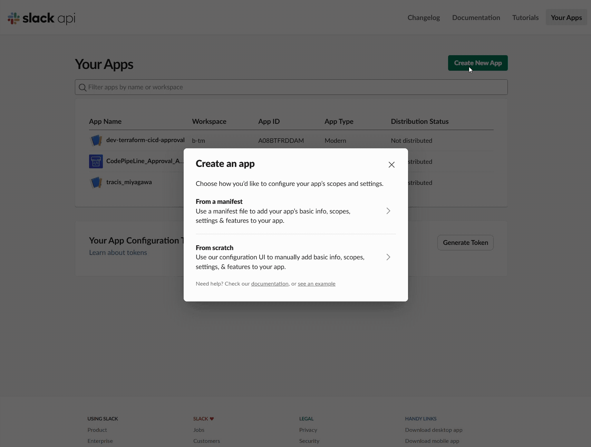
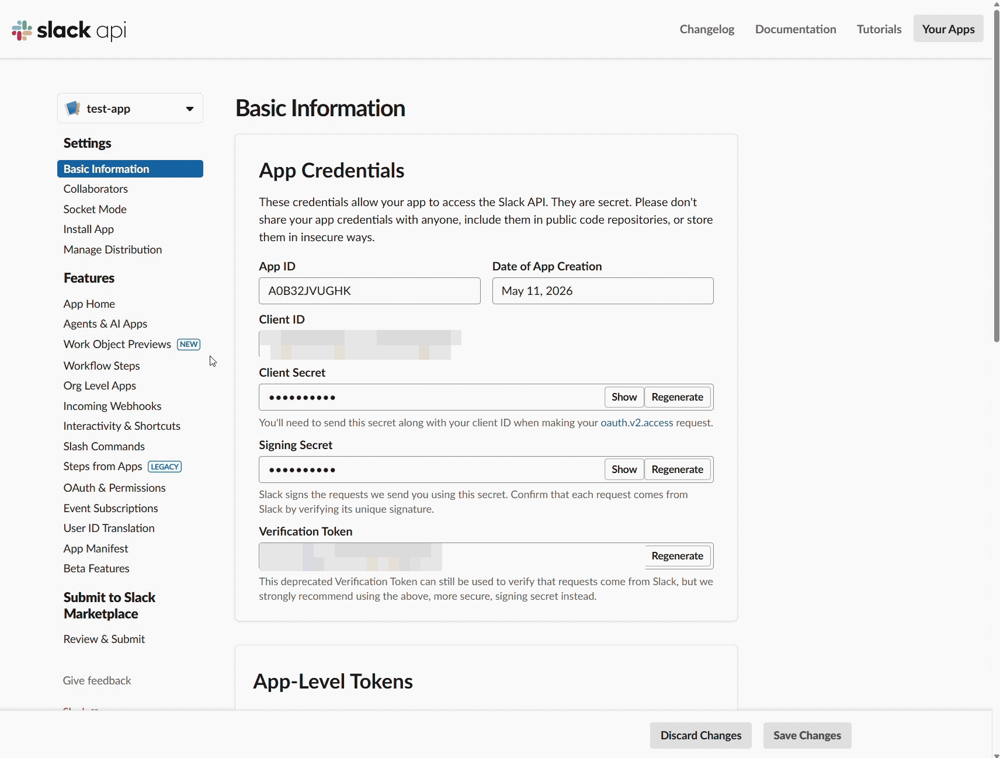
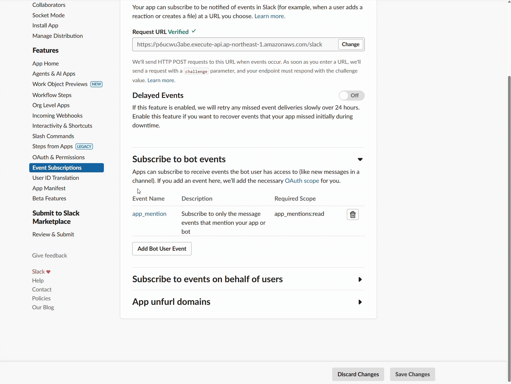
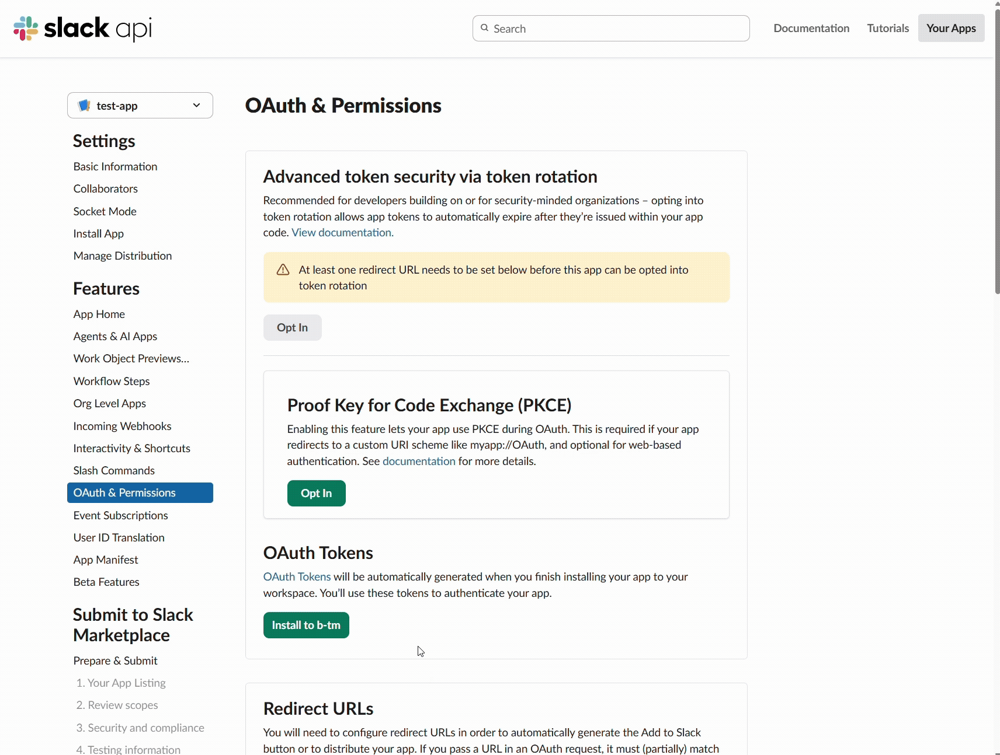

# Slack App の作成


## 作業内容

1. エージェントとの会話に使用するための Slack App を新規作成する
2. 作成した Slack App に必要な設定を行う
3. 作成した Slack App を使用するために Slack チャンネルに招待する


## 前提条件

- [エージェント関連リソースの初期構築](/docs/create_environment/02_build_agent/README.md) までの手順が完了していること

- 上記手順で [`request_api_urls["slack"]`](/docs/create_environment/02_build_agent/README.md#控えておくべき出力値) を確認していること

- 登録済みの Slack アカウントを所持していること


## Slack App の作成手順

1. https://api.slack.com/apps に移動（Slack アカウントでサインイン）
2. [Create New App] をクリック
3. [From scratch]を選択
4. `App Name` にアプリ名を入力
5. `Pick a workspace to develop your app in:` に導入先の Slack Workspace を選択
6. [Create App] をクリックし、新しい Slack App が追加されていることを確認
<br><br>


## Slack App の設定手順

### Event Subscriptions の設定

1. 作成した Slack App の管理画面において、左サイドメニューの [Event Subscriptions] を選択
2. `Enable Events` のトグルスイッチを **On** に切り替え
3. [`request_api_urls["slack"]`](/docs/create_environment/02_build_agent/README.md#控えておくべき出力値) の値を `Request URL` に入力
4. `Subscribe to bot events` セクションで [Add Bot User Event] をクリックし、次のイベントを追加
  - `app_mention`
5. 画面右下の [Save Changes] をクリックし、設定が保存されていることを確認
<br><br>


### 権限の設定

1. 左サイドメニューの [OAuth & Permissions] を選択
2. `スコープ` セクションの `ボットトークンのスコープ` で [OAuth スコープを追加する] をクリックし、次の権限を追加
  - `app_mentions:read`
  - `chat:write`
3. 権限が追加されていることを確認
<br><br>


### Setup アプリ用の OAuth / OIDC 設定（Setup アプリを有効にする場合）

1. CodeBuild の `Outputs` セクションから `setup_app_oidc_redirect_urls["slack"]` を確認する。未出力の場合は `EnableSetupApp=true` でデプロイが完了しているか確認する
2. 同じ Slack App の [OAuth & Permissions] → [Redirect URLs] で [Add New Redirect URL] を選択する
3. 出力された URL をそのまま登録し、[Save URLs] で保存する。例: `https://xxxxxxxxxx.cloudfront.net/api/oidc/slack/callback`
4. [Basic Information] → [App Credentials] の `Client ID` と `Client Secret` を確認し、[Secret の準備](/docs/create_environment/04_prepare_secret/README.md) に従って共有 Secret に格納する

Setup アプリは Sign in with Slack の OpenID Connect 認証を使用し、認証時に `openid` スコープを要求します。Bot 用の `app_mentions:read` / `chat:write` は上記の会話用設定として維持してください。設定の詳細は [Slack 公式の Sign in with Slack](https://docs.slack.dev/authentication/sign-in-with-slack/) を参照してください。

Redirect URL には Event Subscriptions の Request URL ではなく、`/api/oidc/slack/callback` で終わる HTTPS URL を指定します。

### Workspace へのインストール

1. 左サイドメニューの [Install App] を選択
2. [Install to <ワークスペース名>] をクリック
3. Slack へのアクセス許可確認画面に遷移するので [許可する] をクリック
4. Slack App が Workspace にインストール済みであることを確認
<br><br>


## Slack App のチャンネル招待手順

| 項目                     | 利用範囲・運用方法                                                                                                                                                         |
| :----------------------- | :------------------------------------------------------------------------------------------------------------------------------------------------------------------------- |
| 利用できるメンバー       | Slack App を招待したチャンネルで、ボットユーザーをメンションできるメンバー全員が TracisAI を利用できます。Setup アプリを有効にしている場合は、Setup アプリも利用できます。 |
| Setup アプリでできること | ロググループや MySQL テーブルの構造を確認し、共有ナレッジベースに情報を登録できます。                                                                                      |
| 利用メンバーの管理       | 利用者を絞る場合は、プライベートチャンネルを作成し、必要なメンバーと Slack App だけを招待してください。                                                                    |
| App の招待先の管理       | 別のチャンネルに Slack App を招待すると、そのチャンネルのメンバーも利用できます。App の招待先と、招待できるメンバーの範囲も適切に管理してください。                        |

1. Slack App を使用したい Slack チャンネルを開く
2. 下記メッセージを送信し、Slack App を招待
  ```
  /invite @<Slack App の名前>
  ```
3. Slack App が招待されていることを確認


## 次の手順
[Secret の準備](/docs/create_environment/04_prepare_secret/README.md)
